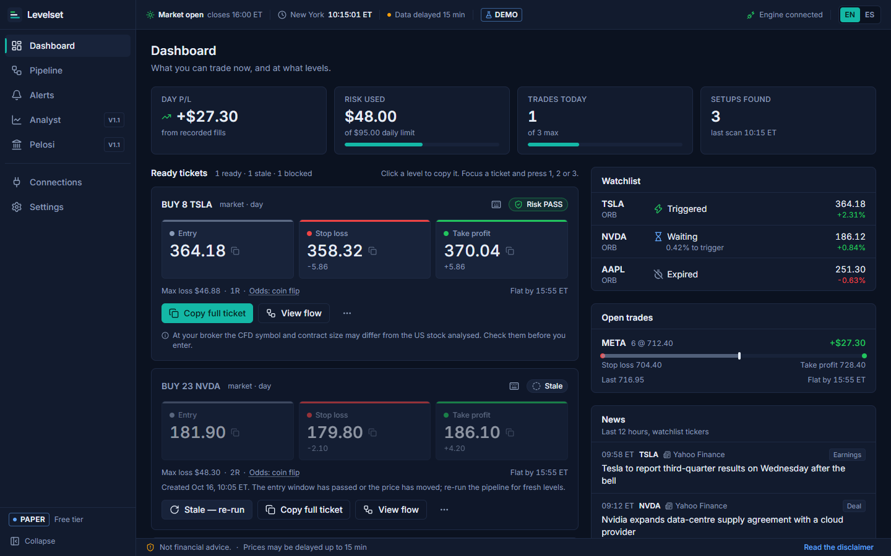
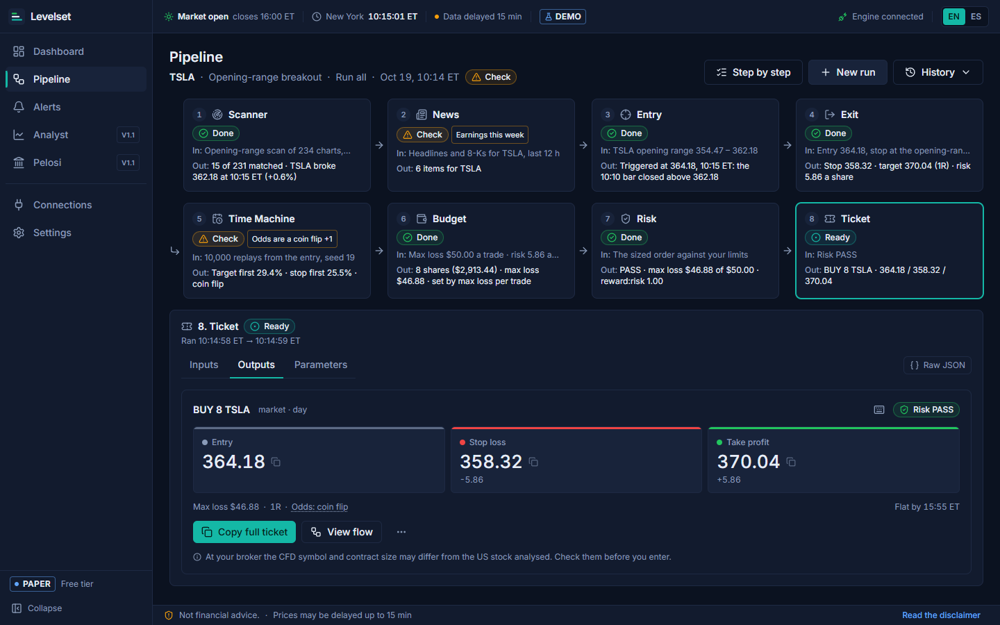
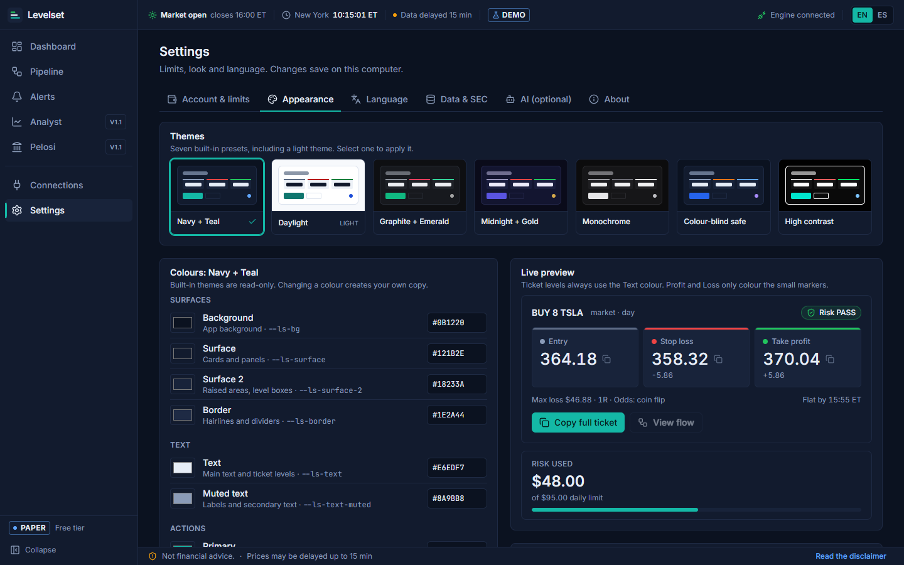
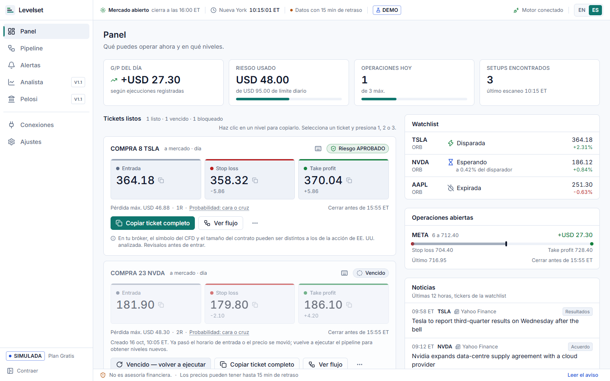
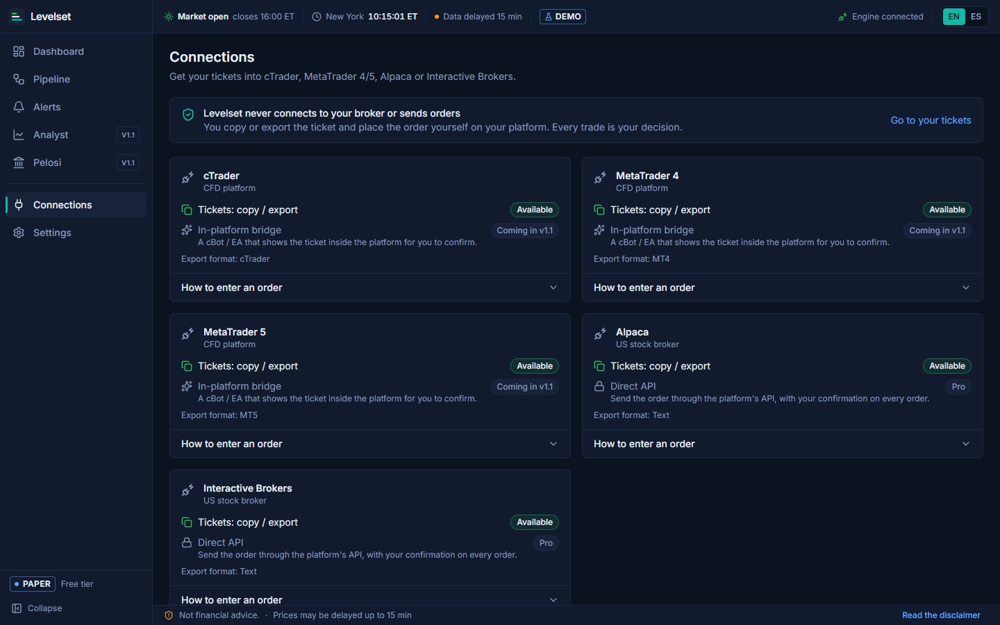
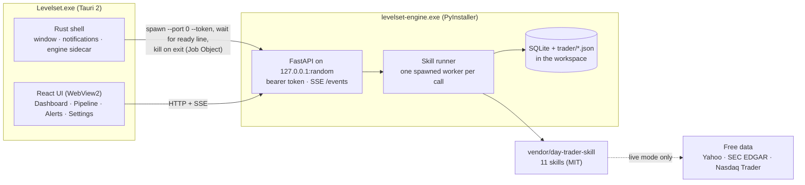

# Levelset

**A desktop trading cockpit for the [day-trader-skill](https://github.com/Jakeschincariol/day-trader-skill) pack.**
Every trade ends in one clear ticket with an **entry**, a **stop loss** and a **take profit**,
and you can see every step of the pipeline that produced it: the scan, the news, the entry
signal, the exit plan, 10,000 simulated sessions, the position size and the risk check.

Levelset runs on your own Windows PC, uses free market data and **never places an order**. You
read the ticket and place the trade yourself, on your own platform.

> **Web demo:** `https://<user>.github.io/Levelset/` (placeholder: published by `.github/workflows/pages.yml`)

The app is available in **English and Spanish** (switch it any time from the status bar).

## Screenshots

| | |
| --- | --- |
|  |  |
|  |  |
|  | |

_Screenshots come from the built-in demo (mock engine, TSLA on 2026-10-19). Regenerate with `node app/scripts/screenshots.mjs` while `npm run dev:mock -- --port 5174` runs._

## Features

- **Clear tickets**: entry, stop loss and take profit as the biggest numbers on the card, with
  share count, max loss at the stop, R multiple and the flat-by time. Click a price to copy it.
- **Transparent pipeline**: eight steps (scanner, news, entry, exit, time machine, budget, risk,
  ticket), each with its inputs, outputs and checks. Run them all at once or one by one.
- **Risk first**: your max loss per trade, daily loss limit, trades per day, reward:risk minimum
  and entry window are enforced by the trader-risk skill before a ticket is marked ready.
- **Alerts**: stop, target, flat-by and price alerts with desktop notifications.
- **Demo mode**: offline fixtures and a pinned clock (Mon 2026-10-19 10:15 ET), so you can try
  the whole flow without market data. The README example ends at 8 x TSLA, entry 364.18,
  stop 358.32, target 370.04.
- **Themes**: seven presets including colour-blind safe and high contrast, fully customisable.
- **Private**: the engine listens on 127.0.0.1 only, with a random port and a per-launch token.
  No telemetry.

## Tech stack

| Layer | Choice |
| --- | --- |
| Desktop shell | Tauri 2 (Rust), WebView2 |
| UI | React 18, TypeScript, Vite, Tailwind CSS, Radix/shadcn, TanStack Query, Zustand, react-i18next |
| Engine | Python 3.14, FastAPI, Uvicorn, SQLite; wraps the vendored skills unchanged |
| Packaging | PyInstaller (engine sidecar), Tauri bundler, NSIS per-user installer |
| Tests | Vitest + Testing Library, pytest, the skills' own unittest suite, cargo test |
| CI | GitHub Actions: CI, release (draft), GitHub Pages demo |

## Architecture



More in [docs/ARCHITECTURE.md](docs/ARCHITECTURE.md), [docs/PRD.md](docs/PRD.md),
[docs/SCREENS.md](docs/SCREENS.md) and the API contract [docs/api/openapi.yaml](docs/api/openapi.yaml).

## Run from source

Requirements: Windows 10/11, Python 3.12+ (3.14 used), Node 24, Rust (stable) with the MSVC
build tools, WebView2 (preinstalled on Windows 10/11).

```powershell
# engine
cd engine
python -m venv .venv
.venv\Scripts\pip install -e .[dev]
.venv\Scripts\python -m levelset_engine --port 8765 --token dev --demo

# app in a browser, against that engine
cd app
npm install
npm run dev            # http://localhost:1420
npm run dev:mock       # or: no engine at all, in-browser mock

# desktop window
npm run tauri dev      # starts the engine from engine\.venv itself (random port + token)
```

To point the desktop app at an engine you started yourself, set `LEVELSET_ENGINE_URL`
(and `LEVELSET_ENGINE_TOKEN`) before `npm run tauri dev`; the app then does not spawn one.

Tests: `cd engine && .venv\Scripts\python -m pytest -q` ·
`.venv\Scripts\python -m unittest discover -s vendor\day-trader-skill\tests` ·
`cd app && npm test && npm run lint && npm run typecheck && npm run i18n:check` ·
`cd app\src-tauri && cargo test`.

## Build the installer

```powershell
powershell -ExecutionPolicy Bypass -File engine\packaging\build.ps1   # engine exe + smoke test + stage sidecar
cd app
npm run tauri:build
# -> app\src-tauri\target\release\bundle\nsis\Levelset_0.1.0_x64-setup.exe
```

The installer is per-user (no admin rights), adds a Start menu entry and bundles the engine, so
no Python is needed on the target PC. Demo mode in the installed app: set `LEVELSET_DEMO=1`, or
create an empty file named `demo` in `%APPDATA%\app.levelset.desktop\`. Details:
[engine/packaging/README.md](engine/packaging/README.md).

## Web demo

`cd app && npm run build:demo` builds a static demo to `app\dist-demo` (mock engine in the
browser, hash routing, base path `/Levelset/`, override with `VITE_BASE`). The Pages workflow
builds and deploys it on every push to `main`.

## Licence and credits

Levelset is released under the [MIT License](LICENSE).

It includes the [day-trader-skill](https://github.com/Jakeschincariol/day-trader-skill) pack by
Jake Schincariol (MIT), vendored unchanged in `engine/vendor/day-trader-skill`. See [NOTICE](NOTICE).

## Disclaimer

Levelset is a tool you run yourself. It is **not financial advice**, not a broker, not an
adviser and not a signal service, and nothing it shows is a recommendation to buy or sell.
Trading involves substantial risk; most day traders lose money. Free market data can be delayed,
incomplete or wrong, and simulations and past results do not guarantee future outcomes. You
decide and place every trade yourself.
